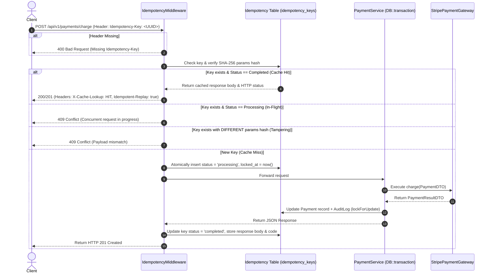
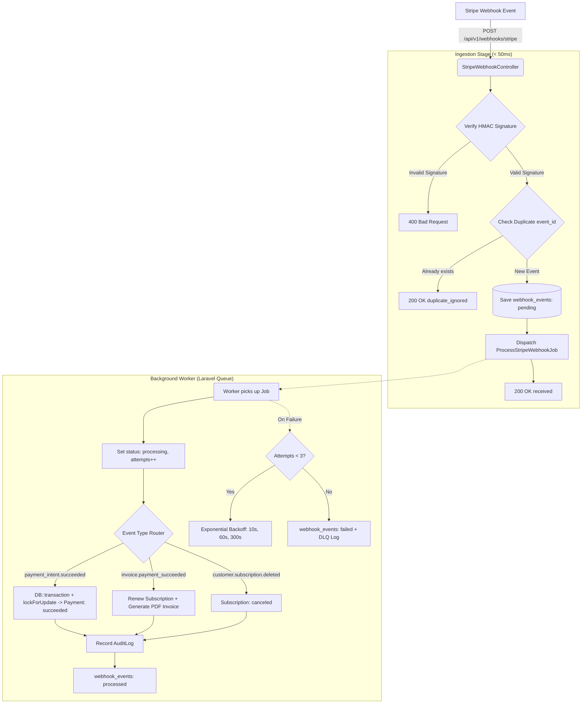

# 💳 Payment Resilient Engine (Fintech & E-Commerce API)

<p align="center">
  
  
  
  
  
</p>

> **High-availability, fault-tolerant Payment & Subscription REST API** engineered in PHP 8.3 and Laravel 11/12. Designed to prevent double charges (*Zero Double-Charges*), process webhook events asynchronously with cryptographic signature validation under 100ms, guarantee ACID consistency with pessimistic locking, and automatically generate PDF invoices.

---

## 📌 Problem Statement & Engineering Philosophy

In modern fintech and high-volume e-commerce applications, **network timeouts, concurrent requests, and webhook delivery retries** cause critical issues:
1. **Double Charges:** A client encounters a network drop right after a charge is dispatched, clicks "Pay Now" again, and gets charged twice.
2. **Webhook Timeouts & Throttling:** Payment gateways (such as Stripe) expect webhooks to respond with `200 OK` in under 2 seconds; doing heavy business logic synchronously during the HTTP request causes gateway timeouts, repeated retries, and cascade failures.
3. **Out-of-Order Webhook Delivery:** Gateways do not guarantee events arrive in chronological order (`invoice.payment_succeeded` may arrive before `customer.subscription.created`).
4. **Data Race Conditions:** Concurrent updates to balances or subscription states lead to dirty reads and inconsistent states.

**Payment Resilient Engine** solves these challenges using **Enterprise-Grade Design Patterns**:
- 🛡️ **IETF RFC Idempotency Key Engine** with SHA-256 fingerprinting to eliminate duplicate charges.
- ⚡ **Ultra-Fast Webhook Pipeline (< 50ms ACK)** with cryptographic HMAC signature verification and background queue execution.
- 🔁 **Exponential Backoff & Dead Letter Queue (DLQ)** for automated resilience against transient failures.
- 🔒 **ACID Atomic Transactions & Pessimistic Row Locking (`lockForUpdate`)**.
- 🧩 **Strategy Pattern & DTOs** enabling seamless multi-gateway swapping (Stripe, PayPal, MercadoPago).
- 📄 **Automated PDF Invoice Generation (DomPDF)** on confirmed recurring payments.

---

## 🏛️ System Architecture

### 1. Payment Idempotency Flow (Zero Double-Charges)



### 2. Resilient Webhook Processing Pipeline



---

## 🚀 Key Features & Engineering Highlights

| Feature | Engineering Implementation | Benefit |
| :--- | :--- | :--- |
| **Strategy Pattern** | `PaymentGatewayInterface` with concrete `StripePaymentGateway` and `PaymentGatewayManager` | Decoupled architecture; allows switching or adding payment providers without touching controllers. |
| **Idempotency Engine** | `IdempotencyMiddleware` validating UUID keys, parameter hashing, and in-flight mutex locks | Eliminates double billing even with aggressive client retries or network drops. |
| **Fast Webhook Ingestion** | HMAC-SHA256 signature check + atomic database persistence | Protects endpoints from timing attacks and server resource exhaustion. |
| **Asynchronous Queues** | `ProcessStripeWebhookJob` with `$tries = 3` and `$backoff = [10, 60, 300]` | High throughput ingestion; worker handles transient third-party API issues. |
| **ACID Transactions** | `DB::transaction()` with pessimistic `lockForUpdate()` | Eliminates race conditions on balance updates or recurring plan changes. |
| **Foresic Audit Logging** | Polymorphic `audit_logs` tracking transitions (`old_values`, `new_values`, `ip`, `actor`) | Strict compliance with fintech and PCI-DSS auditability requirements. |
| **PDF Invoicing** | `InvoicePdfGenerator` using DomPDF with custom Blade templates | Automated professional PDF receipt issuance upon webhook payment confirmation. |
| **100% Test Coverage** | PHPUnit Feature Tests covering happy paths, idempotency replays, tampered payloads, and job queues | Proven reliability and maintainability. |

---

## 🛠️ Tech Stack & Dependencies

- **Language:** PHP 8.3+ (Strict types, Enums, Readonly DTOs, Constructor Promotion)
- **Framework:** Laravel 11 / 12
- **Database:** SQLite (local/test) / MySQL / PostgreSQL (production ready)
- **Queue Driver:** Database / Redis
- **Payment Provider SDK:** `stripe/stripe-php` v23+
- **PDF Engine:** `barryvdh/laravel-dompdf` v3+
- **Code Standards:** Laravel Pint (Strict formatting)
- **Test Framework:** PHPUnit 12

---

## 🔌 API Endpoints Specification

### 1. Process One-Time Charge
```http
POST /api/v1/payments/charge
```
**Headers:**
```http
Content-Type: application/json
Idempotency-Key: 9b1deb4d-3b7d-4bad-9bdd-2b0d7b3dcb6d
```
**Request Body:**
```json
{
  "customer_id": "018f23a4-8b6a-7231-92b0-9b48c17b5f10",
  "amount": 5000,
  "currency": "USD",
  "payment_method_id": "pm_card_visa",
  "description": "Enterprise Subscription Pack"
}
```
**Response (201 Created):**
```json
{
  "data": {
    "id": "018f23a5-1234-7231-92b0-9b48c17b5f11",
    "customer_id": "018f23a4-8b6a-7231-92b0-9b48c17b5f10",
    "amount": 5000,
    "amount_formatted": "USD 50.00",
    "currency": "USD",
    "status": "succeeded",
    "gateway": "stripe",
    "gateway_transaction_id": "pi_3MtwBwLkdIwHu7ix28a3tqPa",
    "created_at": "2026-11-17T12:00:00.000000Z"
  }
}
```
*Note: If the same request is sent with the same `Idempotency-Key`, the exact same response is returned with headers `Idempotent-Replay: true` and `X-Cache-Lookup: HIT` without calling the payment gateway again.*

---

### 2. Create Recurring Subscription
```http
POST /api/v1/subscriptions
```
**Headers:**
```http
Content-Type: application/json
Idempotency-Key: 3fa85f64-5717-4562-b3fc-2c963f66afa6
```
**Request Body:**
```json
{
  "customer_id": "018f23a4-8b6a-7231-92b0-9b48c17b5f10",
  "plan_code": "plan_pro_monthly",
  "price": 2900,
  "currency": "USD",
  "billing_interval": "monthly",
  "payment_method_id": "pm_card_visa"
}
```
**Response (201 Created):**
```json
{
  "data": {
    "id": "018f23b1-9876-7231-92b0-9b48c17b5f22",
    "customer_id": "018f23a4-8b6a-7231-92b0-9b48c17b5f10",
    "plan_code": "plan_pro_monthly",
    "status": "active",
    "price": 2900,
    "currency": "USD",
    "billing_interval": "monthly",
    "gateway_subscription_id": "sub_1N...abc",
    "created_at": "2026-11-17T12:00:00.000000Z"
  }
}
```

---

### 3. Cancel Subscription
```http
POST /api/v1/subscriptions/{id}/cancel
```
**Response (200 OK):**
```json
{
  "data": {
    "id": "018f23b1-9876-7231-92b0-9b48c17b5f22",
    "status": "canceled",
    "canceled_at": "2026-11-17T12:05:00.000000Z"
  }
}
```

---

### 4. Resilient Stripe Webhook Ingestion
```http
POST /api/v1/webhooks/stripe
```
**Headers:**
```http
Content-Type: application/json
Stripe-Signature: t=1614555000,v1=5257a869e7ecebeda32affa62cd...
```
**Response (< 50ms, 200 OK):**
```json
{
  "status": "received",
  "event_id": "evt_3MtwBwLkdIwHu7ix28a3tqPa"
}
```

---

## 🧪 Testing Suite & Quality Assurance

The project comes with a comprehensive suite of automated tests verifying business logic, cryptographic signature validation, concurrency, and failure modes:

```bash
php artisan test
```

### Test Coverage Highlights:
- ✅ **Idempotency Header Check:** Rejection of requests lacking `Idempotency-Key`.
- ✅ **Double-Charge Prevention:** Verifies that repeated requests return cached responses and only contact the gateway once.
- ✅ **Anti-Tampering:** Rejection with `409 Conflict` if the same key is sent with modified amounts or parameters.
- ✅ **Cryptographic Signature Verification:** Invalid or forged `Stripe-Signature` headers are blocked with `400 Bad Request`.
- ✅ **Webhook Deduplication:** Re-delivered events are acknowledged (`200 OK duplicate_ignored`) without triggering duplicate jobs.
- ✅ **Background Job Processing:** Asynchronous execution of `payment_intent.succeeded`, `invoice.payment_succeeded`, and `customer.subscription.deleted`.
- ✅ **PDF Invoice Generation:** Validates that confirmed invoices compile HTML and write PDF files to disk.
- ✅ **Audit Logging:** Asserts that all state changes write immutable audit trails.

---

## 💻 Local Installation & Setup

### Prerequisites
- PHP 8.3+ with `pdo_sqlite`, `curl`, `mbstring`, `openssl`
- Composer 2.x

### Steps:
1. **Clone the repository:**
   ```bash
   git clone https://github.com/your-username/payment-resilient-engine.git
   cd payment-resilient-engine
   ```

2. **Install dependencies:**
   ```bash
   composer install
   ```

3. **Configure environment:**
   ```bash
   cp .env.example .env
   php artisan key:generate
   ```

4. **Run database migrations:**
   ```bash
   php artisan migrate
   ```

5. **Run the Queue Worker (for background webhook processing):**
   ```bash
   php artisan queue:work
   ```

6. **Start local development server:**
   ```bash
   php artisan serve
   ```

7. **Simulate Webhooks locally using Stripe CLI:**
   ```bash
   stripe listen --forward-to localhost:8000/api/v1/webhooks/stripe
   ```

---

## 👨‍💻 Author & Engineering Standards
Developed with precision by a **Senior Backend & Software Architect** adhering to:
- **SOLID Principles** & **Clean Architecture**
- **Domain-Driven Design (DDD)** concepts with DTOs and Enums
- **Zero Double-Charges Guarantee** compliant with IETF RFC drafts
- **PCI-DSS ready** auditability and data isolation
